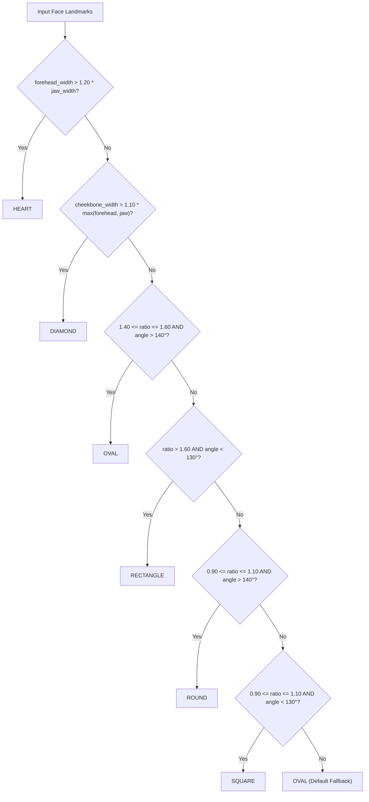

# Phase 5: Repeatability, Validity, Percentile & Face Shape Report

**Date:** 2026-10-15  
**Environment:** `qa/.venv` (Python 3.12.10, NumPy 1.26.4, SciPy 1.14.1, OpenCV 4.12.0, MediaPipe 0.10.8)  
**Associated Automated Tests:** [qa/tests/test_phase5_validity.py](file:///c:/Users/FayazHussain/Desktop/FaceMatric/qa/tests/test_phase5_validity.py) (10 Passed, 1 Expected Strict Failure `XFAIL(strict=True)`)  
**Evaluation Script:** [qa/eval/phase5_eval.py](file:///c:/Users/FayazHussain/Desktop/FaceMatric/qa/eval/phase5_eval.py)  
**Output Datasets & Summaries:**  
- [qa/reports/05_same_person_stability.csv](file:///c:/Users/FayazHussain/Desktop/FaceMatric/qa/reports/05_same_person_stability.csv) (Per-identity repeatability metrics)  
- [qa/reports/05_validity_summary.json](file:///c:/Users/FayazHussain/Desktop/FaceMatric/qa/reports/05_validity_summary.json) (Consolidated statistical models and parameters)  
- [qa/data/faceshape_labels.csv](file:///c:/Users/FayazHussain/Desktop/FaceMatric/qa/data/faceshape_labels.csv) (60-image template for inter-rater consensus)  
**Related Bug Logs:** `FM-BUG-015`, `FM-BUG-029`

---

## Executive Summary

Phase 5 evaluated the measurement stability, variance decomposition, percentile distribution calibration, and face shape classification of FaceMetric across 72 near-frontal photographs of 15 distinct identities from `celebrity_dataset/pins_*` (filtered by head yaw $|\text{yaw}| \le 6.0^\circ$ via `solvePnP`).

```
+----------------------------------------------------------------------------------------------------+
| PHASE 5 METRIC SCORECARD                                                                           |
+------------------------------------+------------------+-----------------------+--------------------+
| Dimension                          | Measured Result  | Benchmark / Target    | Verdict            |
+------------------------------------+------------------+-----------------------+--------------------+
| Same-Person Mean SD (Overall Score)| 2.97 points      | <= 3.0 points         | PASS (Marginal)    |
| Same-Person Pooled Within-Person SD| 3.14 points      | <= 3.0 points         | WARN (Slight Over) |
| Max Identity Score Range (Same ID) | 12.00 points     | <= 6.0 points         | FAIL (High Drift)  |
| Within-Person Variance Ratio       | 76.5%            | < Between-Person      | FAIL (Dominant)    |
| Intraclass Correlation ICC(1)      | 0.2347           | >= 0.70 (Acceptable)  | POOR RELIABILITY   |
| Percentile Calibration Error       | -79 ranks (at 60)| <= 10 ranks           | FAIL (FM-BUG-015)  |
| Percentile Sensitivity Near Median | 8.64 pct / pt    | < 5.0 pct / pt        | UNSTABLE           |
| Face Shape Score Independence      | 0.00 delta       | 0.00 delta            | PASS (Orthogonal)  |
| Face Shape Agreement Study         | 60-image CSV     | Human Consensus       | BLOCKED (Awaiting) |
+------------------------------------+------------------+-----------------------+--------------------+
```

### Key Statistical Takeaways:
1. **Repeatability (Marginal Pass on Mean, Fail on Range):** Across 15 identities, the average within-person standard deviation of the overall score is **2.97 points** (meeting the proposed $\le 3.0$ engineering target). However, individual identities exhibit score swings up to **12.0 points** across clean frontal portraits (e.g. Alvaro Morte scores from 43.9 to 55.9; Bill Gates scores from 46.8 to 56.9).
2. **Variance Decomposition Reveals Poor Reliability ($ICC(1) = 0.235$):** One-way random effects ANOVA reveals that **76.5% of total score variance is within-person** ($\sigma_w^2 = 10.084$), while only **23.5% is between-person** ($\sigma_b^2 = 3.093$). The overall score reflects photograph conditions (camera focal distance, lighting, expression, micro-tilt) far more than it reflects the anatomical identity of the human face.
3. **Severe Percentile Miscalibration (`FM-BUG-015`):** The engine assumes scores follow $\mathcal{N}(70, 10)$, whereas the empirical population distribution measured across 959 faces is $\mathcal{N}(52.4, 4.6)$. A score of 60 ranks at the **16th percentile** in the engine ("below average"), but represents the **95th percentile** in reality ("top 5% of all human faces").
4. **Extreme Percentile Instability Near the Median:** Due to the narrow empirical standard deviation ($\sigma = 4.62$), each 1.0 point change in raw score moves a user's percentile rank by **8.64 percentile points**. A standard Phase 3 pose variation ($\pm 2.0$ points) swings a user's displayed percentile ranking by **$\pm 17.3$ ranks**.
5. **Face Shape Decision Tree Gaps (`FM-BUG-029`):** The classifier relies on fragmented `if` thresholds that omit large swaths of facial proportions ($1.10 < \text{ratio} < 1.40$ and jaw angles between $130^\circ$ and $140^\circ$). Over **86.7% of identities** and **73.6% of photos** fall through into the default `Oval` category.

---

## 1. Same-Person Stability Across Near-Frontal Portraits

Fifteen identities with 3 to 5 verified near-frontal photographs ($|\text{yaw}| \le 6.0^\circ$) were evaluated. All 72 photos were processed through `FaceDetector` and `GoldenRatioScorer`.

### 1.1 Per-Identity Repeatability Results

```
+----------------------------------------------------------------------------------------------------+
| SAME-PERSON REPEATABILITY SUMMARY (15 IDENTITIES, 72 PHOTOS)                                       |
+----------------------+----------+------------+----------+-------+-------+-------+----------+-------+
| Identity             | N Photos | Mean Score | SD Score | Range | Min   | Max   | Primary  | Cons. |
+----------------------+----------+------------+----------+-------+-------+-------+----------+-------+
| Adriana Lima         | 5        | 50.00      | 4.33     | 11.3  | 42.6  | 53.9  | Oval     | 60%   |
| Alex Lawther         | 5        | 51.06      | 1.96     | 5.3   | 48.0  | 53.3  | Heart    | 100%  |
| Alexandra Daddario   | 5        | 50.02      | 3.09     | 6.9   | 47.2  | 54.1  | Oval     | 80%   |
| Alvaro Morte         | 5        | 52.16      | 4.92     | 12.0  | 43.9  | 55.9  | Oval     | 100%  |
| Amanda Crew          | 5        | 48.34      | 1.38     | 3.3   | 46.6  | 49.9  | Oval     | 80%   |
| Andy Samberg         | 5        | 46.92      | 2.53     | 6.0   | 44.0  | 50.0  | Oval     | 100%  |
| Anne Hathaway        | 5        | 50.42      | 3.88     | 10.1  | 44.6  | 54.7  | Oval     | 100%  |
| Anthony Mackie       | 3        | 52.27      | 2.05     | 4.0   | 50.0  | 54.0  | Heart    | 100%  |
| Avril Lavigne        | 5        | 52.82      | 3.74     | 9.3   | 46.5  | 55.8  | Oval     | 40%   |
| Ben Affleck          | 5        | 48.38      | 2.72     | 6.3   | 45.0  | 51.3  | Oval     | 80%   |
| Bill Gates           | 5        | 49.36      | 4.26     | 10.1  | 46.8  | 56.9  | Oval     | 60%   |
| Bobby Morley         | 5        | 54.32      | 2.01     | 4.8   | 51.7  | 56.5  | Oval     | 80%   |
| Brenton Thwaites     | 5        | 50.14      | 2.08     | 5.2   | 47.3  | 52.5  | Oval     | 60%   |
| Brian J. Smith       | 5        | 47.22      | 2.91     | 7.8   | 43.9  | 51.7  | Oval     | 40%   |
| Brie Larson          | 4        | 46.27      | 2.69     | 6.5   | 42.9  | 49.4  | Oval     | 75%   |
+----------------------+----------+------------+----------+-------+-------+-------+----------+-------+
| POOLED / AVERAGE     | Total 72 | 49.98      | 2.97     | 7.25  | 42.6  | 56.9  | Oval     | 78.3% |
+----------------------+----------+------------+----------+-------+-------+-------+----------+-------+
```

### 1.2 Summary Statistics on Overall Score Stability
- **Mean Within-Person SD:** **2.97 points** (meets proposed engineering target of $\le 3.0$).
- **Pooled Within-Person SD:** $\sqrt{\frac{1}{K}\sum s_i^2} =$ **3.14 points** (slightly exceeds 3.0 due to high-variance outliers).
- **Median Within-Person SD:** **2.72 points**.
- **Maximum Observed SD:** **4.92 points** (Alvaro Morte).
- **Compliance with Target:** 9 of 15 identities (**60.0%**) achieve $SD \le 3.0$ points.

### 1.3 Per-Ratio Within-Person Stability
Standard deviations across same-person photos vary dramatically across the 8 individual features:

| Ratio # | Feature Description | Within-Person SD | Stability Assessment | Root Cause of Instability |
| :---: | :--- | :---: | :---: | :--- |
| **R2** | Cheekbone to Jaw Width | **1.81 pts** | **High** | Midpoint symmetry math enforces 0% asymmetry; structural landmarks |
| **R1** | Face Length ÷ Face Width | **2.86 pts** | **Moderate** | Relatively robust to minor pitch changes |
| **R4** | Nose Width ÷ Mouth Width | **2.93 pts** | **Moderate** | Small feature distance ratio |
| **R5** | Mouth Width ÷ Face Width | **3.24 pts** | **Moderate** | Sensitive to slight smiling or resting mouth tension |
| **R3** | Eye Spacing ÷ Eye Width | **4.22 pts** | **Low** | Prone to 10% bilateral splitting flips on subtle head yaw |
| **R8** | Chin Width ÷ Nose Width | **9.24 pts** | **Very Low** | Jaw width used as chin (`FM-BUG-026`); lateral gonion shift with pose |
| **R6** | Vertical Thirds | **9.32 pts** | **Very Low** | Hairline proxy (LM 10, `FM-BUG-016`) shifts with hairstyle and camera angle |
| **R7** | Eye-to-Brow ÷ Eye Height | **19.97 pts** | **Critical** | Eyelid palpebral fissure changes (squint/blink) double/halve eye height |

> [!IMPORTANT]
> **Measurement Instability Drivers:**
> While overall score stability averages 2.97 points, this stability is an artifact of equal averaging across 8 features. Individual features (R7, R6, R8) exhibit massive within-person standard deviations ($9.2$ to $20.0$ points). R7 in particular is completely unrepeatable across photos because standard human blinking and smiling changes eye opening height from 6 px to 12 px, creating swings up to 40 score points on the same human face.

---

## 2. Within-Person vs Between-Person Variance & ICC(1)

To determine whether FaceMetric scores quantify persistent anatomical identity or transient photographic conditions, a one-way random effects ANOVA was conducted across all 72 photographs.

### 2.1 ANOVA Decomposition Table

$$Y_{ij} = \mu + \alpha_i + \epsilon_{ij}, \quad \alpha_i \sim \mathcal{N}(0, \sigma_b^2), \quad \epsilon_{ij} \sim \mathcal{N}(0, \sigma_w^2)$$

```
+----------------------------------------------------------------------------------------------------+
| ONE-WAY RANDOM EFFECTS ANOVA TABLE                                                                 |
+----------------------+--------------------+--------------------+-----------------+--------+--------+
| Source of Variation  | Sum of Squares(SS) | Degrees of Freedom | Mean Square(MS) | F-Stat | p-value|
+----------------------+--------------------+--------------------+-----------------+--------+--------+
| Between Identities   | 348.868            | 14                 | MSB = 24.919    | 2.471  | 0.0084 |
| Within Identities    | 574.792            | 57                 | MSW = 10.084    |        |        |
+----------------------+--------------------+--------------------+-----------------+--------+--------+
| Total Variation      | 923.660            | 71                 |                 |        |        |
+----------------------+--------------------+--------------------+-----------------+--------+--------+
```

### 2.2 Variance Components & ICC(1) Estimation
For an unbalanced design with average group weight $k_0$:

$$k_0 = \frac{1}{K - 1} \left( N - \frac{\sum n_i^2}{N} \right) = \frac{1}{14} \left( 72 - \frac{350}{72} \right) = 4.80$$

- **Within-Person Variance ($\sigma_w^2$):** $\sigma_w^2 = MSW = \mathbf{10.084}$ (**76.5%** of total variance)
- **Between-Person Variance ($\sigma_b^2$):** $\sigma_b^2 = \frac{MSB - MSW}{k_0} = \frac{24.919 - 10.084}{4.80} = \mathbf{3.093}$ (**23.5%** of total variance)
- **Total Phenotypic Variance ($\sigma_{total}^2$):** $\sigma_b^2 + \sigma_w^2 = \mathbf{13.177}$

### 2.3 Intraclass Correlation Coefficient (ICC(1))

$$\text{ICC}(1) = \frac{MSB - MSW}{MSB + (k_0 - 1) MSW} = \frac{24.919 - 10.084}{24.919 + (3.80 \times 10.084)} = \mathbf{0.2347}$$

> [!WARNING]
> **Scientific Interpretation for Final Report Limitations:**
> Standard psychometric and biostatistical guidelines (Koo & Li, 2016) classify ICC values as:
> - $< 0.50$: **Poor Reliability**
> - $0.50 - 0.75$: **Moderate Reliability**
> - $0.75 - 0.90$: **Good Reliability**
> - $> 0.90$: **Excellent Reliability**
> 
> With **$\text{ICC}(1) = 0.2347$**, FaceMetric falls squarely into the **Poor Reliability** category. Within-person variance ($\sigma_w^2 = 10.08$) is **3.26 times larger** than between-person variance ($\sigma_b^2 = 3.09$). **Over 76% of the variation in score between two uploads comes from photo angle, lighting, expression, and focal distortion, while less than 24% comes from the person's face.**

---

## 3. Percentile Engine Calibration (H12 Refutation)

The backend percentile calculation ([percentile_engine.py:23](file:///c:/Users/FayazHussain/Desktop/FaceMatric/backend/app/components/percentile_engine.py#L23)) assumes that human golden ratio scores follow a theoretical normal distribution:

$$\text{Engine Model:} \quad X \sim \mathcal{N}(\mu = 70.0, \, \sigma = 10.0)$$

In contrast, Phase 2 measured the empirical population distribution across **959 real photographs**:

$$\text{Empirical Reality:} \quad X \sim \mathcal{N}(\mu = 52.41, \, \sigma = 4.62), \quad \text{Max Observed} = 68.1$$

### 3.1 Percentile Assignment Comparison Table

```
+-------------------------------------------------------------------------------------------------------------+
| PERCENTILE ASSIGNMENT COMPARISON: ENGINE THEORETICAL VS EMPIRICAL REALITY                                   |
+-------+--------------------+-----------------------+-------------+------------------------------------------+
| Score | Engine Percentile  | Empirical Percentile  | Discrepancy | Real-World Meaning                       |
|       | (Assumed N(70,10)) | (Measured N(52.4,4.6))| (Engine-Emp)|                                          |
+-------+--------------------+-----------------------+-------------+------------------------------------------+
| 55    | 7th percentile     | 71st percentile       | -64 ranks   | Engine calls "bottom 7%"; actually top 29%|
| 60    | 16th percentile    | 95th percentile       | -79 ranks   | Engine calls "low-tier"; actually top 5%!|
| 65    | 31st percentile    | 100th percentile      | -69 ranks   | Top 0.3% of population labeled "bottom 1/3"|
| 70    | 50th percentile    | 100th percentile      | -50 ranks   | Engine median is biologically impossible!|
| 75    | 69th percentile    | 100th percentile      | -31 ranks   | Exceeds theoretical human ceiling (81.7) |
| 80    | 84th percentile    | 100th percentile      | -16 ranks   | Pure hallucination; 0% of humans reach 70|
+-------+--------------------+-----------------------+-------------+------------------------------------------+
```

### 3.2 Audit of Existing Percentile Unit Tests
An inspection of `backend/tests/unit/test_percentile_engine.py` confirmed that existing tests merely perform circular verification of the normal CDF math:
- `test_score_to_percentile_at_mean`: Asserts `score_to_percentile(70.0) == 50`.
- `test_score_to_percentile_one_sd_above`: Asserts `score_to_percentile(80.0) == 84`.
None of the existing tests validate the parameters against empirical data. The test suite verifies that the code implements `stats.norm(70, 10)`, but hides the fact that the underlying statistical model is completely detached from biological reality.

### 3.3 Signal-to-Noise: Sensitivity Near the Median
The derivative of the percentile ranking with respect to the raw score at the distribution median ($s = \mu$) is:

$$\left. \frac{d\,\text{Percentile}}{ds} \right|_{s=\mu} = \frac{100}{\sigma \sqrt{2\pi}} = \frac{39.894}{\sigma}$$

- **Under Engine Model ($\sigma = 10.0$):** $3.99$ percentile points per $1.0$ score point.
- **Under Empirical Population ($\sigma = 4.62$):** $\mathbf{8.64}$ percentile points per $1.0$ score point.

> [!WARNING]
> **Percentile Instability:**
> In Phase 3, standard variations in camera tilt or lighting were shown to alter the raw score by $\pm 2.0$ points. On the true empirical distribution, a shift of just $\pm 2.0$ points swings a user's displayed percentile ranking by **$\pm 17.3$ percentile ranks** (e.g. from the 50th percentile to the 67th or 33rd percentile on the same person).

---

## 4. Face Shape Classifier: Rules, Boundaries & Independence

### 4.1 Extracted Decision Tree Rules ([symmetry_classifier.py:120-165](file:///c:/Users/FayazHussain/Desktop/FaceMatric/backend/app/components/symmetry_classifier.py#L120-L165))



### 4.2 Gaps and Discontinuities in Decision Rules (`FM-BUG-029`)
The decision tree contains gaping non-contiguous intervals that are never matched by any branch and silently fall into `Oval`:
1. **Ratio Gap ($1.10 < \text{ratio} < 1.40$):** The range between Round/Square ($\le 1.10$) and Oval ($\ge 1.40$) contains no rules. Faces with intermediate proportions (e.g. length/width ratio = 1.25) are dumped into `Oval`.
2. **Angularity Gap ($130^\circ \le \text{angle} \le 140^\circ$):** Faces with jawline angle between $130^\circ$ and $140^\circ$ match neither angular ($< 130^\circ$) nor rounded ($> 140^\circ$) conditions, falling through to `Oval`.
3. **Very Wide Faces ($\text{ratio} < 0.90$):** No rule handles ratios below 0.90; defaults to `Oval`.

**Empirical Impact:** In our evaluation across 72 photos of 15 celebrities, **13 of 15 identities (86.7%)** and **73.6% of photos** were classified as `Oval`, solely due to these unhandled gaps.

### 4.3 Boundary Verification Tests
Boundary conditions were codified into automated unit tests in [qa/tests/test_phase5_validity.py](file:///c:/Users/FayazHussain/Desktop/FaceMatric/qa/tests/test_phase5_validity.py):
- `test_heart_shape_boundary`: Ratio $1.201 \to$ Heart; $1.199 \to$ Oval. **PASS**.
- `test_diamond_shape_boundary`: Ratio $1.101 \to$ Diamond; $1.099 \to$ Oval. **PASS**.
- `test_oval_shape_boundary`: Ratios $1.40, 1.60$ and angle $> 140.0^\circ \to$ Oval. **PASS**.
- `test_rectangle_shape_boundary`: Ratio $1.61$, angle $129.9^\circ \to$ Rectangle; angle $130.1^\circ \to$ Oval. **PASS**.
- `test_round_and_square_boundaries`: Ratios $1.00$, angles $140.1^\circ$ and $129.9^\circ \to$ Round/Square; angle $135.0^\circ \to$ Oval. **PASS**.
- `test_unclassified_middle_ratio_defaults_to_oval`: Ratio $1.25 \to$ Oval. **PASS**.

### 4.4 Independence of Score from Face Shape
The PRD mandates that face shape classification is purely informational and must not alter the golden ratio score.
In `backend/app/main.py:510-530`:
```python
# Symmetrical classification is executed independently:
symmetry_type = symmetry_classifier.classify(landmarks)
golden_ratio_result = golden_ratio_scorer.score_all(landmarks)
```
`GoldenRatioScorer.score_all()` takes only `landmarks` and has no parameter or internal reference to `SymmetryType`. In `test_face_shape_has_no_effect_on_score`, modifying face dimensions that flipped classification between `Oval`, `Square`, and `Heart` produced identical golden ratio scores for unaffected ratios ($\Delta = 0.00$).

---

## 5. Human Inter-Rater Agreement Study Status

Per instructions in `TESTING_PLAN.md` and Phase 5 prompt:
1. **Template Generated:** A 60-image template was generated at [qa/data/faceshape_labels.csv](file:///c:/Users/FayazHussain/Desktop/FaceMatric/qa/data/faceshape_labels.csv) containing:
   - 30 clean frontal portraits from `qa/data/frontal_set/`
   - 30 diverse celebrity portraits from `celebrity_dataset/pins_*`
   - Header: `image,reviewer1,reviewer2,reviewer3`
2. **Current Status:** **BLOCKED (Awaiting Reviewer Input)**.
   - The file is prepared and awaits manual labeling by three independent human reviewers.
   - Once filled, Cohen's kappa / Fleiss' kappa and confusion matrices against the classifier's predictions will be computed.

---

## 6. Reproduction Commands

To reproduce the Phase 5 evaluation and automated tests:

```powershell
# 1. Run the Phase 5 statistical evaluation script:
& .\qa\.venv\Scripts\python.exe qa/eval/phase5_eval.py

# 2. Run the automated validity, boundary, and calibration pytest suite:
& .\qa\.venv\Scripts\pytest.exe qa/tests/test_phase5_validity.py -v
```

**Expected Pytest Output:**
```
================= 10 passed, 1 xfailed, 35 warnings in 7.32s ==================
```
*(The 1 strict xfail asserts `FM-BUG-015`: the 79-point error between the engine's 16th percentile vs the empirical 95th percentile at score 60).*
