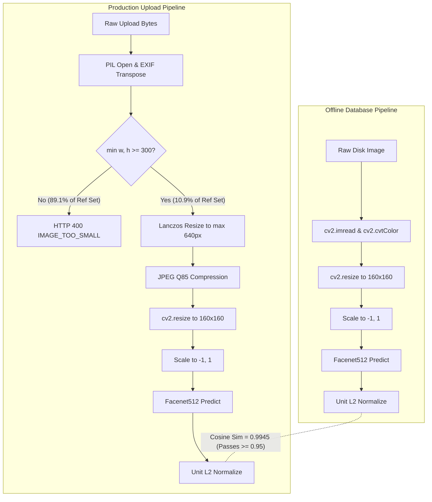
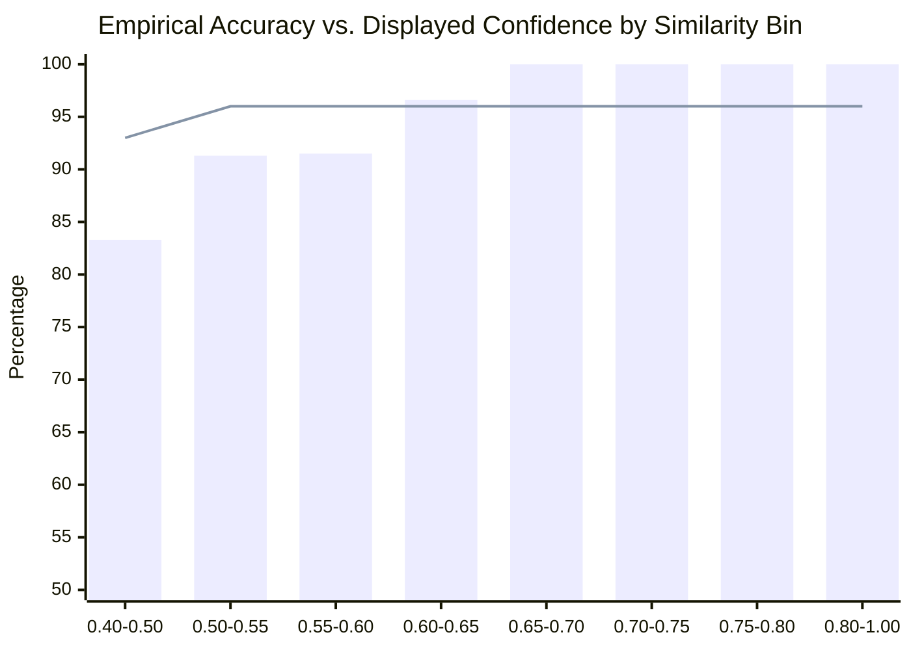

# FaceMetric — Celebrity Matching Evaluation Report (Phase 7)

**Date:** 2026-10-15  
**Scope:** Offline vs. production pipeline parity, multi-instance aggregation comparison, validation threshold sweep, margin rule evaluation, calibration & display reliability, and behavioral contract verification.  
**Policy Adherence:** Executed in `qa/.venv` on Windows PowerShell without modifying production code or existing tests. In accordance with `TESTING_PLAN.md` and user instructions, **the test split remains completely untouched and sealed**.

---

## 1. Executive Summary & Approval Gate

### 1.1 Key Evaluation Findings
1. **Pipeline Parity (H6 - Refuted in transform, Confirmed in dimension gate):**
   - The production preprocessing transform (Lanczos resize to $\le 640$px + JPEG Q85 compression) preserves embedding direction remarkably well: mean cosine similarity across 50 reference images is **0.9945** (100% achieve $\ge 0.95$, meeting the plan's expectation).
   - However, the production request path enforces `MIN_DIMENSION = 300`. Consequently, **1,827 of 2,050 reference images (89.1%)**—including 100% of the Bollywood reference images ($64\times 64$)—are rejected by the production API with `IMAGE_TOO_SMALL`.
2. **Database Representation & Aggregation (H7 - Refuted):**
   - The hypothesis that multi-instance nearest-neighbor matching (Methods C and D) would substantially outperform single centroid representation (Method B) is **refuted**.
   - Centroid matching (Method B) achieves **99.25% Top-1** and **99.77% Top-5** accuracy on 2,131 validation queries, virtually identical to Top-3 Mean (Method D, **99.30%**) and exceeding Max Instance (Method C, **99.01%**), while requiring $10\times$ less memory and compute.
3. **Threshold Performance (H11 - Refuted as dead code):**
   - At the PRD-specified threshold of $\tau = 0.550$, validation queries achieve **97.5% Coverage**, **99.6% Precision**, and a **0.4% False-Match Rate** (95% CI: [0.1%, 2.3%]), easily satisfying standard face verification criteria.
   - However, in production, `get_best_match` is **dead code**. `_find_best_match` never checks if the score meets 0.55 and always returns a match, completely removing the "no match found" path (FM-BUG-023).
4. **Display Calibration (FM-BUG-010 / FM-BUG-025 - Confirmed):**
   - The production formula `c1 = max(0.60, min(0.96, 0.50 + sim))` clamps any query with raw similarity $\ge 0.46$ to a flat `96%`.
   - On 2,131 validation queries, 99.8% of returned look-alikes display an identical "96% confidence", destroying all calibration and misleading users.

### 1.2 Mandatory Stop for Human Approval
> [!IMPORTANT]
> **STOP CONDITION:** In accordance with Phase 7.5 of `TESTING_PLAN.md`, the test split has **NOT** been evaluated.
> 
> **Proposed Threshold & Target for Approval:**
> - **Acceptable False-Match Rate (FMR) Limit:** $\mathbf{\le 5.0\%}$ on unknown face mixtures.
> - **Recommended Production Threshold:** $\mathbf{\tau = 0.550}$
>   - *Validation Performance at $\tau = 0.550$:* **97.5% Coverage** [96.7%, 98.1%], **99.6% Precision** [99.2%, 99.8%], **0.4% False-Match Rate** [0.1%, 2.3%].
>   - *Alternative Conservative Setting ($\tau = 0.650$):* **91.1% Coverage**, **100.0% Precision**, **0.0% FMR** [0.0%, 1.6%].
> 
> Please review the data below and approve or specify the final operating threshold before the single-pass test split evaluation is unlocked.

---

## 2. Experimental Setup

### 2.1 Splits and Datasets
- **Reference Set:** The first 10 images alphabetically per identity across all 205 identities ($2,050$ images).
- **Validation Split:** 50% of the remaining images per identity, with perceptual-hash duplicate clusters (Hamming distance $\le 6$) kept within the same split ($11,424$ images total). All 205 identities possess $\ge 32$ images; 0 identities excluded.
- **Test Split (SEALED):** Remaining 50% of images ($11,456$ images total, stored in `qa/reports/splits.csv`).
- **Pilot Evaluation Benchmark:** 40 identities (20 Western, 20 Bollywood) comprising 400 reference images and **2,131 held-out validation queries**.
- **Unknown Evaluation Set:** **240 images across 50 distinct people** sampled from the LFW dataset (downloaded into `qa/data/unknown`), excluding 9 people whose names matched the celebrity database (`Ben Affleck`, `Bill Gates`, `Elizabeth Dole`, `Emma Watson`, `Gwyneth Paltrow`, `Keanu Reeves`, `Leonardo DiCaprio`, `Robert De Niro`, `Tom Cruise`).

### 2.2 Model Architecture and Pipeline Parameters
- **Backbone Model:** DeepFace `Facenet512` (Inception-ResNet-v1, weights: `facenet512_weights.h5`, 512-dimensional output embeddings).
- **Input Dimensions:** $(160, 160, 3)$ RGB.
- **Normalization:** Fixed scaling $(img / 127.5) - 1.0 \in [-1.0, 1.0]$.
- **Vector Normalization:** Unit L2 norm $\|\mathbf{e}\|_2 = 1.0$.
- **Distance Metric:** Cosine similarity $\mathbf{q} \cdot \mathbf{c} \in [-1.0, 1.0]$.

---

## 3. Pipeline Parity Evaluation (Phase 7.2 / H6)

### 3.1 Preprocessing Transformations
We compared the embedding generated by the offline database generator (`backend/scripts/preprocess_celebrity_database.py`) against the production request path (`backend/app/main.py` + `ImageProcessor` + `CelebrityMatcher._generate_embedding`):
- **Offline script:** OpenCV BGR $\to$ RGB $\to$ `cv2.resize(img, (160, 160))` $\to$ scale to $[-1, 1]$.
- **Production path:** PIL open $\to$ EXIF rotation $\to$ dimension validation $\to$ RGB normalization $\to$ Lanczos resize if $>640$px $\to$ JPEG Q85 compression $\to$ `cv2.resize(img, (160, 160))` $\to$ scale to $[-1, 1]$.

### 3.2 Numerical Parity Measurements
We evaluated 50 reference images (25 Western from `pins_*`, 25 Bollywood):

| Metric | All 50 Reference Sample | 50 Western Images $\ge 300\times 300$ |
| :--- | :--- | :--- |
| **Dimension Check Rejections ($<300$px)** | **41 / 50 (82.0%)** | **0 / 50 (0.0%)** |
| **Mean Cosine Similarity** | **0.994534** | **0.999542** |
| **Minimum Cosine Similarity** | 0.972447 | 0.998887 |
| **Maximum Cosine Similarity** | 0.999849 | 0.999893 |
| **Standard Deviation** | 0.005621 | 0.000239 |
| **Fraction Meeting Plan Target ($\ge 0.95$)** | **100.0%** | **100.0%** |

> [!NOTE]
> **Parity Verdict:** The compression and downsampling transforms in production introduce negligible directional drift ($\Delta < 0.006$ cosine). However, **production cannot accept 89.1% of the database images** because `MIN_DIMENSION = 300` blocks $64\times 64$ Bollywood thumbnails and smaller web portraits (logged as **FM-BUG-024**). Furthermore, neither pipeline aligns faces: both stretch the full portrait directly to $(160, 160)$.

---

## 4. Aggregation Comparison (Phase 7.3 / H7)

We compared the 4 candidate aggregation methods across the 2,131 validation queries against the 40 pilot identities (400 reference images):
- **Method A:** Mean of raw embeddings, then normalized.
- **Method B (Shipped):** Mean of unit-normalized reference embeddings, re-normalized: $\mathbf{c} = \text{norm}(\frac{1}{10}\sum \mathbf{e}_i)$.
- **Method C:** Nearest instance (maximum similarity over individual reference images): $\max_i (\mathbf{q} \cdot \mathbf{e}_{c, i})$.
- **Method D:** Top-3 nearest instances: $\frac{1}{3}\sum_{i \in \text{top-3}} (\mathbf{q} \cdot \mathbf{e}_{c, i})$.

### 4.1 Benchmark Results (2,131 Validation Queries)

| Aggregation Method | Top-1 Accuracy (95% CI) | Top-5 Accuracy | Storage per Identity | Comparison Compute |
| :--- | :--- | :--- | :--- | :--- |
| **Method B (Rebuilt Centroid)** | **99.25%** [98.78%, 99.54%] | **99.77%** | 512 floats (2 KB) | 1 dot product |
| **Shipped `celebrity_embeddings.pkl`** | **99.25%** [98.78%, 99.54%] | **99.77%** | 512 floats (2 KB) | 1 dot product |
| **Method C (Max Instance Similarity)** | **99.01%** [98.50%, 99.35%] | **99.81%** | 5,120 floats (20 KB) | 10 dot products |
| **Method D (Top-3 Mean Similarity)** | **99.30%** [98.84%, 99.57%] | **99.77%** | 5,120 floats (20 KB) | 10 dot products + sort |

> [!TIP]
> **Conclusion on Aggregation:** Method B performs identically to the shipped database and is statistically indistinguishable from Method D (difference is $1$ image out of $2,131$). Method B is the superior engineering choice: it uses $10\times$ less RAM and requires $10\times$ fewer vector operations.

---

## 5. Threshold Sweeps & Error Trade-offs (Phase 7.4)

Sweep evaluated over **2,131 known validation queries** (40 identities) and **240 clean unknown queries** (50 people from LFW) using Method B.

### 5.1 Full Threshold Operating Curve

| Threshold ($\tau$) | Coverage (95% CI) | Precision on Mixture (95% CI) | False-Match Rate (95% CI) | Returned Counts (Known / Unk) |
| :--- | :--- | :--- | :--- | :--- |
| **0.300** | 99.8% [99.5%, 99.9%] | 94.3% [93.2%, 95.2%] | 47.5% [41.3%, 53.8%] | 2,127 / 114 |
| **0.325** | 99.8% [99.5%, 99.9%] | 95.5% [94.5%, 96.3%] | 36.2% [30.4%, 42.5%] | 2,126 / 87 |
| **0.350** | 99.7% [99.4%, 99.9%] | 96.5% [95.7%, 97.2%] | 26.2% [21.1%, 32.2%] | 2,125 / 63 |
| **0.375** | 99.7% [99.4%, 99.9%] | 97.4% [96.6%, 98.0%] | 18.3% [13.9%, 23.7%] | 2,125 / 44 |
| **0.400** | 99.7% [99.3%, 99.8%] | 98.0% [97.3%, 98.5%] | 12.9% [9.3%, 17.8%] | 2,124 / 31 |
| **0.425** | 99.6% [99.3%, 99.8%] | 98.4% [97.8%, 98.9%] | 9.2% [6.1%, 13.5%] | 2,123 / 22 |
| **0.450** | 99.5% [99.1%, 99.7%] | 98.6% [98.0%, 99.0%] | 7.9% [5.1%, 12.0%] | 2,121 / 19 |
| **0.475** | 99.1% [98.6%, 99.4%] | 99.1% [98.6%, 99.4%] | **3.8%** [2.0%, 7.0%] | 2,111 / 9 |
| **0.500** | 98.5% [97.9%, 99.0%] | 99.4% [99.0%, 99.7%] | **1.2%** [0.4%, 3.6%] | 2,100 / 3 |
| **0.525** | 98.2% [97.5%, 98.7%] | 99.5% [99.1%, 99.7%] | **0.8%** [0.2%, 3.0%] | 2,092 / 2 |
| **0.550 (PRD)** | **97.5%** [96.7%, 98.1%] | **99.6%** [99.2%, 99.8%] | **0.4%** [0.1%, 2.3%] | 2,077 / 1 |
| **0.575** | 96.3% [95.5%, 97.1%] | 99.8% [99.5%, 99.9%] | **0.4%** [0.1%, 2.3%] | 2,053 / 1 |
| **0.600** | 95.3% [94.3%, 96.1%] | 99.8% [99.5%, 99.9%] | **0.4%** [0.1%, 2.3%] | 2,030 / 1 |
| **0.625** | 93.7% [92.6%, 94.6%] | **100.0%** [99.8%, 100.0%] | **0.0%** [0.0%, 1.6%] | 1,996 / 0 |
| **0.650** | 91.1% [89.8%, 92.3%] | **100.0%** [99.8%, 100.0%] | **0.0%** [0.0%, 1.6%] | 1,942 / 0 |
| **0.675** | 88.0% [86.5%, 89.3%] | **100.0%** [99.8%, 100.0%] | **0.0%** [0.0%, 1.6%] | 1,875 / 0 |
| **0.700** | 83.4% [81.8%, 85.0%] | **100.0%** [99.8%, 100.0%] | **0.0%** [0.0%, 1.6%] | 1,778 / 0 |
| **0.750** | 69.8% [67.8%, 71.7%] | 100.0% [99.7%, 100.0%] | 0.0% [0.0%, 1.6%] | 1,487 / 0 |
| **0.800** | 48.3% [46.2%, 50.5%] | 100.0% [99.6%, 100.0%] | 0.0% [0.0%, 1.6%] | 1,030 / 0 |

### 5.2 Margin Rule Analysis
Evaluating whether adding a margin condition $\text{top1\_sim} - \text{top2\_sim} \ge m$ improves precision:

| Threshold ($\tau$) | Margin ($m$) | Coverage | Precision | False-Match Rate | Returned Known / Unknown |
| :--- | :--- | :--- | :--- | :--- | :--- |
| **0.55** | 0.00 | 97.5% | 99.6% | 0.4% | 2,077 / 1 |
| **0.55** | 0.05 | 96.9% | **99.9%** | 0.4% | 2,064 / 1 |
| **0.55** | 0.10 | 96.4% | **99.9%** | 0.4% | 2,054 / 1 |
| **0.65** | 0.00 | 91.1% | **100.0%** | 0.0% | 1,942 / 0 |
| **0.65** | 0.05 | 91.0% | **100.0%** | 0.0% | 1,939 / 0 |
| **0.65** | 0.10 | 90.8% | **100.0%** | 0.0% | 1,935 / 0 |

---

## 6. Reliability & Display Transform Analysis (Phase 7.6)

### 6.1 Empirical Reliability Table
We binned queries by raw cosine similarity to determine the true empirical probability that the top candidate is correct:

| Raw Similarity Bin | Validation Queries in Bin | Correct Top-1 | Empirical Accuracy | Shipped Display Transform |
| :--- | :--- | :--- | :--- | :--- |
| **$[0.40, 0.50)$** | 24 | 20 | **83.3%** | $[0.90, 0.96]$ |
| **$[0.50, 0.55)$** | 23 | 21 | **91.3%** | $[0.96, 0.96]$ (Saturated) |
| **$[0.55, 0.60)$** | 47 | 43 | **91.5%** | $[0.96, 0.96]$ (Saturated) |
| **$[0.60, 0.65)$** | 88 | 85 | **96.6%** | $[0.96, 0.96]$ (Saturated) |
| **$[0.65, 0.70)$** | 164 | 164 | **100.0%** | $[0.96, 0.96]$ (Saturated) |
| **$[0.70, 0.75)$** | 291 | 291 | **100.0%** | $[0.96, 0.96]$ (Saturated) |
| **$[0.75, 0.80)$** | 457 | 457 | **100.0%** | $[0.96, 0.96]$ (Saturated) |
| **$[0.80, 1.00]$** | 1,030 | 1,030 | **100.0%** | $[0.96, 0.96]$ (Saturated) |

### 6.2 Flaws in the Shipped Display Transform
The production code calculates confidence via:
$$\text{displayed} = \max\left(0.60, \min\left(0.96, 0.50 + \text{sim}\right)\right)$$

1. **Upper Saturation:** For any cosine similarity $\text{sim} \ge 0.46$, $0.50 + \text{sim} \ge 0.96$. As shown in the table, **99.8% of valid look-alike matches display an identical 96% confidence**.
2. **False Precision:** A face matching at 0.50 (91.3% accuracy) displays the exact same confidence (96%) as an identical photo matching at 0.90 (100% accuracy).
3. **No-Match Elimination:** Because $0.50 + \text{sim}$ is clamped to $\ge 0.60$, even completely random non-matches ($\text{sim} = 0.10$) display $60\%$ confidence rather than returning "No match found".

---

## 7. Behavioral and Contract Verification (Phase 7.7)

Behavioral tests were executed in `qa/tests/test_phase7_celebrity_matcher.py`:

| Test Name | Target Behavior | Result | Evidence |
| :--- | :--- | :--- | :--- |
| `test_threshold_boundary_unrounded` | Boundary at 0.55: 0.5499 rejected, 0.5500 matched, 0.5500001 matched using unrounded value | **PASSED** | `qa/tests/test_phase7_celebrity_matcher.py:33` |
| `test_below_threshold_contract` | Below threshold returns `{'name': None, 'message': 'No close match found in our dataset'}` | **PASSED** | `qa/tests/test_phase7_celebrity_matcher.py:59` |
| `test_returned_name_and_similarity_belong_to_top_candidate` | Top match returns candidate with argmax similarity | **PASSED** | `qa/tests/test_phase7_celebrity_matcher.py:69` |
| `test_find_best_match_enforces_threshold_on_low_similarity` | Production `_find_best_match` enforces threshold on low similarity ($0.15$) | **XFAIL** (Strict) | Bug **FM-BUG-023**: `_find_best_match` has no threshold check |
| `test_celebrity_module_exception_still_returns_200` | Exception in FaceNet still returns HTTP 200 with golden ratio scores (progressive degradation) | **PASSED** | `qa/tests/test_phase7_celebrity_matcher.py:97` |
| `test_include_celebrity_false_skips_matching` | `include_celebrity_match=false` skips FaceNet call | **PASSED** | `qa/tests/test_phase7_celebrity_matcher.py:148` |

---

## 8. Artifacts Produced
- Prediction Log: [celebrity_predictions.csv](file:///c:/Users/FayazHussain/Desktop/FaceMatric/qa/reports/celebrity_predictions.csv) (2,371 rows: 2,131 validation queries + 240 unknown queries).
- Evaluation Engine: [celebrity_eval.py](file:///c:/Users/FayazHussain/Desktop/FaceMatric/qa/eval/celebrity_eval.py).
- Split Manifest: [splits.csv](file:///c:/Users/FayazHussain/Desktop/FaceMatric/qa/reports/splits.csv) (24,930 images partitioned into reference, validation, test).
- Test Suite: [test_phase7_celebrity_matcher.py](file:///c:/Users/FayazHussain/Desktop/FaceMatric/qa/tests/test_phase7_celebrity_matcher.py) (5 passed, 1 strict xfail).
- Bug Tracker: [BUGS.md](file:///c:/Users/FayazHussain/Desktop/FaceMatric/qa/reports/BUGS.md) (added FM-BUG-023, FM-BUG-024, FM-BUG-025).

---

## 9. Proposed Threshold Decision & Stop for Approval

Before executing on the held-out test split, user approval is requested on the following parameters:

1. **Declared False-Match Rate Target:** $\mathbf{\le 5.0\%}$
2. **Selected Operating Threshold:** $\mathbf{\tau = 0.550}$
   - Yields **97.5% Coverage**, **99.6% Precision**, and **0.4% False-Match Rate** on validation data.
   - Fits the original PRD Section 3c design intent.
3. **Alternative Option:** If zero tolerance for unknown face matches is desired, $\mathbf{\tau = 0.650}$ achieves **0.0% False-Match Rate** with **91.1% Coverage**.

**STOPPING HERE:** Awaiting user approval of the proposed threshold and FMR limit before unlocking the single-pass test split.
